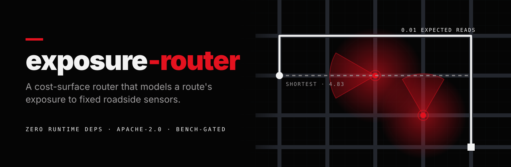
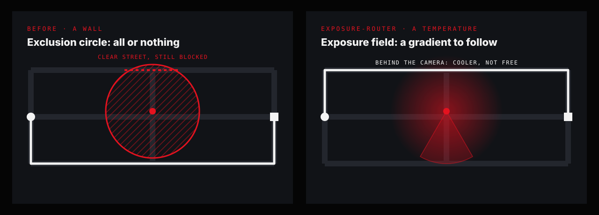
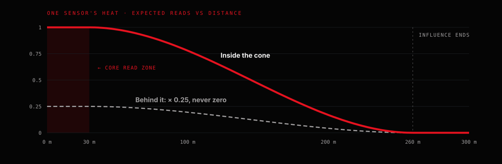

<p align="center">
  
</p>

<p align="center">
  <a href="https://github.com/AcidAlchamy/exposure-router/actions/workflows/ci.yml"></a>
  <a href="LICENSE"></a>
  
  
  
</p>

<p align="center">
  <a href="#quick-start">Quick start</a> ·
  <a href="#api">API</a> ·
  <a href="#the-model">The model</a> ·
  <a href="#by-the-numbers">By the numbers</a> ·
  <a href="#tests-and-benchmarks">Tests</a> ·
  <a href="CONTRIBUTING.md">Contributing</a>
</p>

---

`exposure-router` is a small routing engine. Give it a road graph and a set of
fixed sensors (a position, an optional facing and cone, a confidence); it
returns routes that trade travel distance against how much of the drive falls
within those sensors' fields of view.

It answers *how exposed is this route, and is there a comparable one that is
less so*, and lets you see exactly how the answer is computed: three pure,
dependency-free TypeScript modules, no I/O, no network, no clock.

## The data model cannot hold a person

A sensor is a [`FieldCamera`](src/exposureField.ts): latitude, longitude,
optional facing bearing, optional cone width, confidence. That is the entire
type.

| The type has | The type has no field for |
|---|---|
| position · facing · cone width · confidence | a plate · a vehicle · a face · a timestamp · an owner · an observation |

The engine consumes fixed-equipment geometry and emits routes. It has no notion
of who drives one. Every sensor in this repository is synthetic (see
[Fixtures](#fixtures)); there is no sensor dataset here, by policy.

## Quick start

Not on npm yet. Install from GitHub (it builds on install):

```bash
npm install github:AcidAlchamy/exposure-router
```

Save this as `quick-start.mjs` and run `node quick-start.mjs`:

<!-- quick-start:begin (test/readme.test.ts runs this block) -->
```js
import { buildGraph, nearestNode, routeCostSurface, ExposureField } from "exposure-router";

// A 3 x 3 street grid with 300 m blocks. Node id = row * 3 + column.
const M_PER_DEG = 111_320; // metres per degree of latitude, roughly
const lat0 = 36, lng0 = -115, cosLat = Math.cos((lat0 * Math.PI) / 180);
const nodes = [];
for (let row = 0; row < 3; row++) {
  for (let col = 0; col < 3; col++) {
    nodes.push({ id: row * 3 + col, lat: lat0 + (row * 300) / M_PER_DEG, lng: lng0 + (col * 300) / (M_PER_DEG * cosLat) });
  }
}

// Two-way residential streets between neighbours. geom is [lng, lat] from a to
// b; lengthM must not be shorter than the straight line between the two nodes.
const edges = [];
const street = (a, b) =>
  edges.push({ a: a.id, b: b.id, geom: [[a.lng, a.lat], [b.lng, b.lat]], lengthM: 300, highway: "residential", oneway: false });
for (const n of nodes) {
  if (n.id % 3 < 2) street(n, nodes[n.id + 1]);
  if (n.id < 6) street(n, nodes[n.id + 3]);
}

// One omnidirectional sensor at the centre intersection.
const field = new ExposureField([
  { latitude: nodes[4].lat, longitude: nodes[4].lng, directionDeg: null, fovDeg: null, confidenceScore: 1 },
]);

const graph = buildGraph(nodes, edges);
const start = nearestNode(graph, nodes[3].lat, nodes[3].lng); // west end of the middle street
const goal = nearestNode(graph, nodes[5].lat, nodes[5].lng); // east end

// λ = metres of extra driving one expected read is worth. 0 = plain shortest path.
for (const lambda of [0, 2000]) {
  const route = routeCostSurface(graph, field, start, goal, lambda);
  console.log(`λ=${lambda}: nodes ${route.path.join("→")}, ${route.distanceMeters} m, ${route.reads.toFixed(2)} expected reads`);
}
```
<!-- quick-start:end -->

Output:

```
λ=0: nodes 3→4→5, 600 m, 4.84 expected reads
λ=2000: nodes 3→0→1→2→5, 1200 m, 0.00 expected reads
```

At λ = 0 the route drives past the sensor; at λ = 2000 it takes the street one
block over. Where the graph and the sensor records come from is the caller's
business: the engine never reads a file, a database or the network.

## API

Everything is exported from the package root. Coordinates are WGS84 degrees;
geometry is `[lng, lat]`; distances are metres.

| Export | What it does |
|---|---|
| `buildGraph(nodes, edges)` | Builds adjacency from `GraphNode[]` (`id`, `lat`, `lng`) and `GraphEdge[]` (`a`, `b`, `geom`, `lengthM`, `highway?`, `oneway`). |
| `routeCostSurface(graph, field, startId, goalId, λ)` | A* minimising `lengthM · driveWeight + λ · expectedReads` per edge. Returns `{ path, geometry, distanceMeters, reads }`, or `null` when the goal is unreachable or an id is not in the graph. Start = goal gives a one-node path with empty geometry. |
| `nearestNode(graph, lat, lng)` | Id of the node at the smallest ground distance; `null` for an empty graph. |
| `new ExposureField(cameras)` | Spatial index over `FieldCamera[]`; `.heatAt(lng, lat)` is the summed heat at a point. |
| `cameraHeatAt(camera, lng, lat)` | One sensor's heat at a point, 0..1. |
| `edgeExposure(edge, field)` | Expected reads accumulated driving one edge. |
| `scoreRouteExposureField({ geometry: { coordinates } }, field)` | Expected reads (`score`), `peak` heat and `exposedMeters` along any line. |
| `metersBetween(aLng, aLat, bLng, bLat)`, `INFLUENCE_RADIUS_M` | Great-circle distance; the 260 m radius beyond which a sensor contributes nothing. |
| `findCoolCorridor(from, to, field, { metersPerRead })` | Experimental: grid search for the coolest corridor, returned as up to 10 waypoints. |

Input rules. Bad input throws an error naming the problem (a `RangeError` for
a bad number), never a silent wrong route:

- `λ` / `metersPerRead` is a finite number ≥ 0.
- Coordinates are finite. Sensor `directionDeg`, `fovDeg` and `confidenceScore`
  are finite or `null` (`null` = omnidirectional, default 60° cone, 0.5).
- `lengthM` is ≥ 0, and not shorter than the straight line between the edge's
  nodes (the A* heuristic relies on it). `Infinity` makes an edge impassable.
- Every edge's `a` and `b` are ids of nodes in the graph. `oneway: true` means
  `a → b` only.

## The model

<p align="center">
  
</p>

The simplest way to route around a sensor is an **exclusion circle**: a disc the
route may not enter. A circle is a wall. It blocks every road through it,
including one that passes cleanly 80 m away, and it is all-or-nothing, so there
is no gradient for a search to follow. `exposure-router` models each sensor as a
**temperature** instead.

<p align="center">
  
</p>

- **[`exposureField.ts`](src/exposureField.ts), the heat model.** Heat is 1.0
  inside a 30 m core, falling smoothly to 0 at 260 m. Outside a sensor's cone it
  is reduced, but never below 0.25: facing data is often wrong, and the model
  must not be confidently wrong in the unsafe direction. Confidence scales the
  whole kernel. A route's integral of heat is its *expected reads*, comparable
  across routes of any length or shape.
- **[`graph.ts`](src/graph.ts), the router.** A* over the road graph minimising
  `length · driveWeight + λ · expectedReads` per edge. `driveWeight` is a road-
  class realism term (service roads ×2.6, living streets ×1.25, residential and
  unclassified ×1.05, everything else ×1), so the router stays on streets rather
  than cutting through parking aisles. **λ is the single dial**: how many extra
  metres one expected read is worth.
- **[`corridorSearch.ts`](src/corridorSearch.ts), an experiment.** Dijkstra over
  a grid of the raw heat field, ignoring roads, simplified to a few waypoints for
  a road router to snap to streets. Documented, tested, not finished.

## By the numbers

Every bench scenario routed at λ = 0 (shortest path) and at its judged λ, from
the committed [`bench/baseline.json`](bench/baseline.json); CI fails if they
drift.

| Scenario | Expected reads, shortest → routed | Distance added | Read zones crossed |
|---|---|---|---|
| `parallel-street` | 4.83 → **0.01** | +480 m | 1 → **0** |
| `saturated-downtown` | 16.41 → **5.01** | +1.6 km | 3 → **0** |
| `downtown-lv` (real roads) | 16.34 → **0.43** | +1.66 km | 5 → **0** |
| `parking-lot-temptation` | 0 → 0 | 0 m, and 0 m of service roads | 0 → 0 |
| `flanked-exit` | 9.41 → 9.41 | 0 m | 2 → 2, *on purpose* |

`flanked-exit` is built to fail: every road out passes two sensors and the only
alternative is a ~9 km perimeter that passes one. The correct behaviour is to
keep the short route and report *2 crossings*, not to buy a huge detour for a
marginal gain. A router that always claimed to beat exposure would be lying.

## Tests and benchmarks

```bash
npm test                   # unit, golden-output and seeded property tests
npm run golden:update      # regenerate test/golden/ after an intended output change
npm run bench              # behaviour bench, diffed against bench/baseline.json
npm run bench:perf         # runtime and memory on the larger scenarios
```

- **Golden outputs** ([`test/golden/`](test/golden)) pin the exact route, cost
  and exposure for 15 deterministic cases, from start-equals-goal and ties to an
  80 × 80 random grid and the real-road fixture. Any change fails `npm test`.
- **Property tests** check invariants on thousands of seeded random maps: every
  step is a legal move, reported totals equal the sum over the route, the cost
  equals an exhaustive search and an independent Dijkstra, more λ never means
  more reads, raising cost off the route never changes it, and more.

[CONTRIBUTING.md](CONTRIBUTING.md) explains when each must change and what a
good pull request includes.

## Fixtures

Every sensor in every fixture is synthetic: generated in code and placed to
exercise the router. The bench's synthetic grids (`fixtures/synthetic.ts`) and
the golden and property-test maps (`fixtures/golden.ts`,
`fixtures/randomGraph.ts`, seeded) are abstract. One fixture,
`fixtures/downtown-lv.json`, carries **real road geometry** derived from
OpenStreetMap, with synthetic node ids and no sensors; the scenario places
synthetic sensors on it at runtime. See
[`fixtures/PROVENANCE.md`](fixtures/PROVENANCE.md).

## Contributing

New scenarios, better models, faster search and sharper tests are welcome. A
scenario the router gets wrong is a good first pull request on its own. Read
[CONTRIBUTING.md](CONTRIBUTING.md) first. Security or privacy issue? Report it
privately; see [SECURITY.md](SECURITY.md).

## Licence

**Source code: [Apache-2.0](LICENSE).** Copyright 2026 AcidAlchamy. The patent
grant is deliberate: a routing model meant to be trusted and built on should
carry an explicit one.

**One data file is licensed differently.** `fixtures/downtown-lv.json` is road
geometry derived from OpenStreetMap, a Derivative Database under the
**[Open Database License (ODbL) v1.0](https://opendatacommons.org/licenses/odbl/1-0/)**
(© OpenStreetMap contributors), *not* Apache-2.0. It is left out of the npm
package so an Apache-2.0 package never ships an ODbL database inside it. See
[NOTICE](NOTICE) and [fixtures/PROVENANCE.md](fixtures/PROVENANCE.md).

## A note on framing

This project is about **awareness and transparency** regarding fixed public
equipment. It is not an evasion tool, and contributions (code, comments, tests,
issues, commit messages) are held to that line. "How exposed is this route, and
is there a comparable cleaner one" is a civic question with a checkable answer.

This project is independent and is not affiliated with, endorsed by or
sponsored by any sensor vendor.
