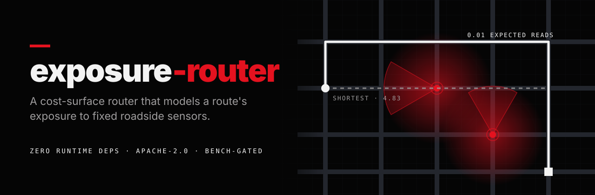
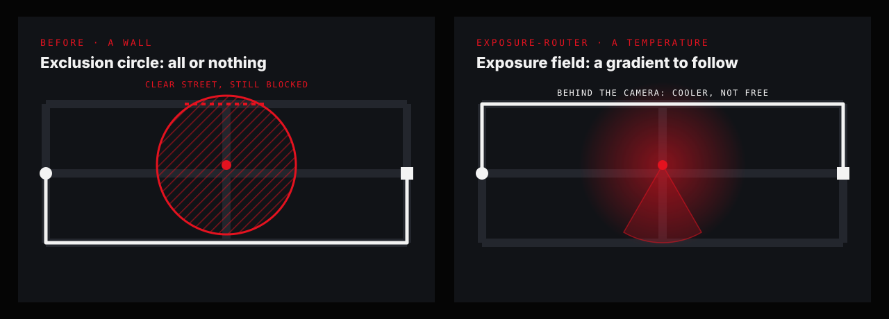
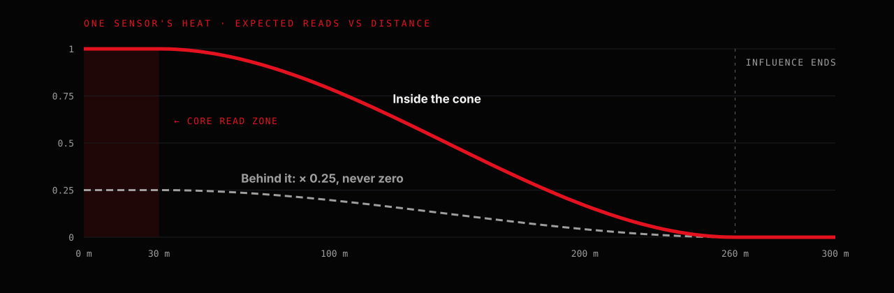

<p align="center">
  
</p>

<p align="center">
  <a href="https://github.com/AcidAlchamy/exposure-router/actions/workflows/ci.yml"></a>
  <a href="LICENSE"></a>
  
  
  
</p>

<p align="center">
  <a href="#the-model">The model</a> ·
  <a href="#by-the-numbers">By the numbers</a> ·
  <a href="#quick-start">Quick start</a> ·
  <a href="#the-benchmark-is-the-point">Benchmark</a> ·
  <a href="CONTRIBUTING.md">Contributing</a>
</p>

---

Give it a road graph and a set of sensor records; it returns routes that trade
travel distance against how much of the drive falls within those sensors' fields
of view.

It is a research and transparency tool. The first thing built on it is
[**Anti-Flock Maps**](https://anti-flock.com), a civic-transparency map of
publicly documented automated licence-plate-reader (ALPR) cameras. ALPR is an
application of this model, not its identity: the model is general, and works for
any fixed sensor with a position, a facing and a cone.

## Why it exists

Public agencies and private networks are mounting fixed sensors on poles and
overpasses. Where they are, which way they face, and how much of a given trip
they can observe are questions with checkable answers. A route is just a line,
so "how much of this line is inside a sensor's cone" is arithmetic.

This library makes that arithmetic legible. For a real road network it answers
*how exposed is this route, and is there a comparable one that is less so*, and
it lets you see exactly how the answer is computed. The whole cost model is a few
hundred lines of pure, dependency-free TypeScript you can read in an afternoon.

## The data model cannot hold a person

This is the most important fact about the library, so it comes first and it is
enforced in code, not just in prose.

A sensor is a [`FieldCamera`](src/exposureField.ts): a latitude, a longitude, an
optional facing bearing, an optional cone width and a confidence score. That is
the entire type.

| The type has | The type has no field for |
|---|---|
| position · facing · cone width · confidence | a plate · a vehicle · a face · a timestamp · an owner · an observation |

The router consumes **fixed-equipment geometry and nothing else**, and it emits
**routes**. It has no notion of who is driving one. Nothing in this repository is
a surveillance dataset, and nothing in it can become one without changing the
types. Every sensor in the fixtures is synthetic (see [Fixtures](#fixtures));
there is no camera database here, by policy.

## The model

<p align="center">
  
</p>

The simplest way to route around sensors is to treat each one as an **exclusion
circle**: a disc the route may not enter. A circle is a wall. It blocks *every*
road through its disc, including the one that passes cleanly 80 m away, so the
router keeps butting into a sensor whenever a slightly longer, genuinely cleaner
street exists one block over. Worse, it is all-or-nothing: moving 5 m further
from a sensor is worth exactly zero until you cross the wall, at which point it
is worth everything. There is no gradient for a search to follow.

`exposure-router` models each sensor as a **temperature** instead of a wall.

<p align="center">
  
</p>

**1. [`exposureField.ts`](src/exposureField.ts): the heat model.** Every sensor
radiates a continuous cost: flat at 1.0 inside a ~30 m core read zone, then a
smooth fall to 0 at a 260 m influence radius. If the sensor has a facing, the heat
outside its cone is knocked down, **but not to zero** (a 0.25 floor): real-world
facing data is often wrong, or describes only one of several heads on the same
pole, and a privacy tool must not be confidently wrong in the unsafe direction.
Confidence scales the whole thing, so a sensor we are unsure exists bends a route
without dominating it. Any point in the world has a temperature, and any route
has an integral of it, in units of *expected reads*: comparable across routes of
different length, shape and road class.

**2. [`graph.ts`](src/graph.ts): the router.** A* over a real road graph,
minimising, per edge:

```
cost = length · driveWeight  +  λ · expectedReads
```

The optimiser flows around heat like water downhill and naturally prefers the
parallel street when it is cheaper overall. `driveWeight` is a per-road-class
multiplier (service roads ×2.6, and so on) that keeps the router on real streets
instead of cutting through parking aisles: a realism term, not a sensor term.
**λ (`metresPerRead`) is the single dial**: how many extra metres of driving one
expected read is worth. λ = 0 is the plain shortest path.

**3. [`corridorSearch.ts`](src/corridorSearch.ts): an experiment, honestly
labelled.** A grid Dijkstra over the raw heat field, ignoring roads entirely, to
find the coolest *corridor* across an area; it then simplifies that to a few
waypoints for a road router to snap to streets. **Anti-Flock Maps does not use
it.** It ships as a documented experiment because the idea is sound and worth
building on, not because it is finished.

## By the numbers

Every scenario in the bench, routed at λ = 0 (the plain shortest path) and at its
judged λ. Numbers come straight from the committed
[`bench/baseline.json`](bench/baseline.json); CI fails if they drift.

| Scenario | Expected reads, shortest → routed | Distance added | Read zones crossed |
|---|---|---|---|
| `parallel-street` | 4.83 → **0.01** | +480 m | 1 → **0** |
| `saturated-downtown` | 16.40 → **5.01** | +1.6 km | 3 → **0** |
| `downtown-lv` (real roads) | 16.34 → **0.43** | +1.66 km | 5 → **0** |
| `parking-lot-temptation` | 0 → 0 | 0 m, and 0 m of service roads | 0 → 0 |
| `flanked-exit` | 9.41 → 9.41 | 0 m | 2 → 2, *on purpose* |

### What it cannot do

A model is only trustworthy if it says where it fails, so the bench includes a
scenario built to fail: **`flanked-exit`**. Every road out of a neighbourhood
passes two sensors, and the only clean-ish alternative is a ~9 km perimeter that
itself passes one. There is no zero-exposure route, and the correct behaviour is
**not** to invent one: it keeps the short, sane route at a reasonable λ and
reports *2 crossings, honestly*, rather than buy a multi-kilometre detour for a
marginal reduction. Exposure is a real constraint of the physical world; a
router that always claimed to beat it would be lying.

## Quick start

It is not on npm yet. Install it straight from GitHub (it builds on install):

```bash
npm install github:AcidAlchamy/exposure-router
```

```ts
import {
  buildGraph, routeCostSurface, nearestNode,
  ExposureField, type FieldCamera,
} from "exposure-router";

const graph = buildGraph(nodes, edges);          // your GraphNode[] / GraphEdge[]
const field = new ExposureField(cameras);         // your FieldCamera[]
const start = nearestNode(graph, from.lat, from.lng)!;
const goal  = nearestNode(graph, to.lat,   to.lng)!;

const route = routeCostSurface(graph, field, start, goal, /* λ */ 2200);
// -> { geometry: [lng,lat][], distanceMeters, reads, path }
```

**Where do `nodes`, `edges` and `cameras` come from? That is your problem, on
purpose.** The library takes assembled geometry and returns routes; it never
reads a database or a network. That seam keeps any real sensor dataset *out* of
this package and private to its owner. Anti-Flock Maps supplies its own road
graph and camera list; neither lives here.

Working on the library itself:

```bash
git clone https://github.com/AcidAlchamy/exposure-router.git
cd exposure-router
npm install          # dev dependencies only; the library has zero runtime deps
npm test             # node --test, no bundler
npm run bench        # the measuring stick (below)
```

## The benchmark is the point

Code without a measuring stick generates unvettable pull requests and dies of
maintainer fatigue. `npm run bench` routes every scenario at λ = 0 and at its
judged λ, and prints crossed read zones, the exposure integral (expected reads),
distance, distance added, metres spent on service roads, and runtime. The
committed [`bench/baseline.json`](bench/baseline.json) turns any behaviour change
into a visible diff.

```bash
npm run bench              # print the table, diff against the baseline
npm run bench -- --check   # CI mode: exit 1 on any drift
npm run bench -- --update  # rewrite the baseline with today's numbers
```

> [!IMPORTANT]
> **A pull request that changes routing behaviour must include its bench diff.**
> "Feels better" is not evidence. This is what makes reviewing a routing change
> objective instead of a judgement call. See [CONTRIBUTING.md](CONTRIBUTING.md).

## Fixtures

`fixtures/` holds the scenarios the bench runs. **Every sensor in every fixture
is synthetic**: generated by code, placed to exercise the router, and not a real
camera location. Three are faithful reconstructions of real cases the engine once
got wrong, rebuilt abstractly so no real place is named:

- `parallel-street`: the founding case the cost surface was built to solve.
- `flanked-exit`: the honest-failure case above.
- `parking-lot-temptation`: a regression where a missing road-class term let the
  router "win" by cutting through 285 parking aisles. The drivability weight is
  what fixes it.

One fixture, `downtown-lv.json`, carries **real road geometry**: a downtown Las
Vegas subgraph derived from OpenStreetMap. Its node ids are synthetic and it
contains **no sensors**; the scenario places synthetic sensors on it at runtime.
Road geometry is © OpenStreetMap contributors, ODbL 1.0. See
[`fixtures/PROVENANCE.md`](fixtures/PROVENANCE.md).

## Contributing

Contributions are welcome: new scenarios, better models, faster search, sharper
tests. A scenario the router gets wrong is a great first pull request on its own.
Read [CONTRIBUTING.md](CONTRIBUTING.md) first; the short version:

1. A behaviour change lands with its bench diff.
2. New behaviour needs a test, and `src/` stays pure (no I/O, no clock, no network).
3. Framing discipline applies to code, comments, tests, commits and issues.
4. The maintainer reviews and merges; every contributor is credited.

Security or privacy issue? Please report it privately; see [SECURITY.md](SECURITY.md).

## Licence

**Source code: [Apache-2.0](LICENSE).** Copyright 2026 AcidAlchamy. The patent
grant is deliberate: a routing model meant to be trusted and built on should
carry an explicit one.

**One data file is licensed differently.** `fixtures/downtown-lv.json` is road
geometry derived from OpenStreetMap and is therefore a Derivative Database under
the **[Open Database License (ODbL) v1.0](https://opendatacommons.org/licenses/odbl/1-0/)**
(© OpenStreetMap contributors), *not* Apache-2.0. It is left out of the npm
package so an Apache-2.0 package never ships an ODbL database inside it. See
[NOTICE](NOTICE) and [fixtures/PROVENANCE.md](fixtures/PROVENANCE.md).

## A note on framing

This project is about **awareness and transparency** regarding fixed public
equipment. It is not an evasion tool, and contributions (code, comments, tests,
issues, commit messages) are held to that line. "How exposed is this route, and
is there a comparable cleaner one" is a civic question with a checkable answer.
That question, answered in the open, is the whole point.

This project and Anti-Flock Maps are independent. They are not affiliated with,
endorsed by or sponsored by Flock Safety or any other sensor vendor.
